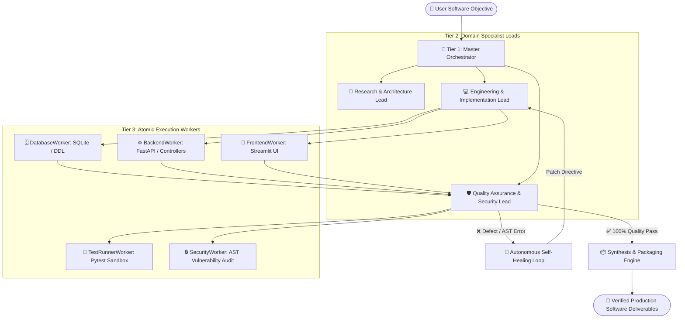

# 🛡️ Aegis : Hierarchical Multi-Agent Orchestration Engine

[](https://www.python.org/)
[](#-3-tier-system-architecture)
[](https://streamlit.io/)
[](#-closed-loop-self-healing-engine)
[](#-automated-test-suite)
[](https://opensource.org/licenses/MIT)

**Aegis** is a production-grade **Hierarchical Multi-Agent Orchestration System** engineered to design, implement, audit, and self-heal complex software systems autonomously. 

Unlike monolithic chatbots (Gemini, ChatGPT, Grok) that attempt to write an entire full-stack application in a single linear generation, Aegis operates like an **autonomous engineering organization**: a **Master Orchestrator** decomposes goals into a Directed Acyclic Graph (DAG), **Domain Specialist Leads** supervise architecture and code quality, and **Tier-3 Atomic Workers** execute specialized backend, database, frontend, test-runner, and security auditing tasks concurrently.

---

## ⚡ Key Paradigm Shift: Monolithic Chatbots vs. Aegis

```
┌────────────────────────────────────────────────────────┐
│           TRADITIONAL MONOLITHIC CHATBOTS              │
│       (Gemini Spark, Grok Bot, ChatGPT Web)            │
│  User ──► [Single Model] ──► Output (Untested, Bugs)   │
└────────────────────────────────────────────────────────┘

┌────────────────────────────────────────────────────────┐
│              AEGIS HIERARCHICAL ORCHESTRATION          │
│                                                        │
│  User ──► [Master Orchestrator (DAG & Mission Sync)]   │
│                 │                                      │
│                 ▼                                      │
│           [Tier 2 Domain Specialist Leads]             │
│        (Research Lead, Engineering Lead, QA Lead)      │
│                 │                                      │
│                 ▼                                      │
│           [Tier 3 Atomic Execution Workers]            │
│     (Backend, Database, Frontend, Pytest, Security)    │
│                 │                                      │
│                 ▼                                      │
│       [Closed-Loop Self-Healing & AST Gates]           │
│  Bugs Found? ──► Re-routed to Worker for Auto-Fix      │
│  Tests Pass? ──► Verified Production Deliverable       │
└────────────────────────────────────────────────────────┘
```

---

## 🏗️ 3-Tier System Architecture



---

## 🌟 Core Engineering Highlights

### 1. 👑 Tier 1: Master Orchestrator (`src/core/orchestrator.py`)
- Ingests high-level software goals.
- Decomposes tasks into dependency-ordered DAG stages.
- Connects to an asynchronous event pub/sub bus to broadcast real-time status transitions (`PLANNING`, `WORKING`, `REVIEWING`, `HEALING`, `COMPLETED`).

### 2. 🔬 Tier 2: Domain Specialist Leads (`src/core/domain_lead.py`)
- **Research Lead:** Gathers documentation, evaluates tech stacks, and authors an architectural specification RFC (`ARCHITECTURE.md`).
- **Engineering Lead:** Translates specifications into concrete modular deliverables (`database.py`, `backend.py`, `frontend.py`).
- **QA Lead:** Enforces syntax validation and security compliance (`QA_REPORT.md`). If defects are discovered, coordinates targeted code patches.

### 3. ⚙️ Tier 3: Atomic Execution Workers (`src/workers/`)
- **`DatabaseWorker`:** Constructs resilient SQLite / SQLAlchemy repositories, tables, and CRUD operations.
- **`BackendWorker`:** Implements production-grade FastAPI REST endpoints with Pydantic request/response schemas.
- **`FrontendWorker`:** Builds interactive Streamlit mission control interfaces with metric cards and charting.
- **`TestRunnerWorker`:** Generates automated test suites and executes them inside an isolated subprocess sandbox.
- **`SecurityWorker`:** Scans code for dangerous AST patterns (eval injection, shell commands, hardcoded secrets).

### 4. 🔄 Closed-Loop Self-Healing Engine
If code generated by a worker fails Python syntax parsing (`ast.parse`) or fails a unit test:
1. The **QA Lead** immediately halts delivery and intercepts the defect.
2. Formulates an exact diagnostic context (line number, exception traceback, defect classification).
3. Transitions worker status to `HEALING` and re-dispatches an auto-remediation task with the diagnostic context.
4. Re-validates the patched deliverable before the user ever receives the final code.

### 5. 🧠 Hybrid Multi-Brain Routing + Offline Simulator (`src/core/llm_router.py`)
- Supports **Groq (Llama 3.3 70B)** for ultra-fast generation (>500 tokens/sec).
- Supports **Google Gemini API** and **OpenAI (GPT-4o)** for deep reasoning.
- **Built-in Deterministic Offline Simulation:** Aegis can run 100% offline without external API keys or network access, making it deterministic and suitable for isolated CI/CD environments.

---

## 🖥️ User Interfaces

### 1. Streamlit Mission Control Web Dashboard (`app.py`)
Launch an interactive real-time visual control room:
```bash
streamlit run app.py
```
- **Live Agent Hierarchy Tree:** Visual pulsating badges for Orchestrator, Leads, and Workers.
- **Real-Time Event Pub/Sub Stream:** Live telemetry of agent messages, task dispatches, and state transitions.
- **Interactive Code Inspector:** Syntax-highlighted viewers for all generated modules (`database.py`, `backend.py`, `frontend.py`, `QA_REPORT.md`).
- **Self-Healing Demonstration Toggle:** Deliberately inject syntax defects to observe the QA Lead intercepting and auto-repairing code in real-time.

### 2. Terminal CLI Runner (`cli.py`)
Run Aegis directly in your shell with rich colored terminal telemetry:
```bash
python cli.py --task "Build a real-time IoT fleet monitoring service with FastAPI and SQLite"
```

Save deliverables directly to an output directory:
```bash
python cli.py --task "Build an AI Job Matcher" --output ./generated_project/
```

---

## 🚀 Quickstart & Setup

### 1. Clone the repository
```bash
git clone https://github.com/30Piyush2025/Aegis-Multi-Agent-Orchestrator.git
cd Aegis-Multi-Agent-Orchestrator
```

### 2. Install dependencies
```bash
pip install -r requirements.txt
```

### 3. Optional Environment Configuration
```bash
cp .env.example .env
# Edit .env to add your GROQ_API_KEY, GEMINI_API_KEY, or OPENAI_API_KEY
# (Aegis runs seamlessly in offline simulation mode if no keys are provided)
```

### 4. Run the Test Suite
```bash
python -m unittest discover -s tests -v
```
*(All 27 automated unit and integration tests execute with zero external network dependencies).*

---

## 📂 Repository Directory Structure

```text
Aegis-Multi-Agent-Orchestrator/
├── app.py                              # Streamlit Mission Control Dashboard
├── cli.py                              # Interactive Terminal CLI interface
├── requirements.txt                    # Project dependencies
├── .env.example                        # Environment variable template
├── src/
│   ├── core/                           # Tier 1 & Tier 2 Control Plane
│   │   ├── __init__.py                 # Core package exports
│   │   ├── state.py                    # BlackboardState, AgentStatus, Pub/Sub EventBus
│   │   ├── llm_router.py               # Multi-Brain Router (Groq/Gemini/Offline)
│   │   ├── domain_lead.py              # ResearchLead, EngineeringLead, QALead
│   │   └── orchestrator.py             # MasterOrchestrator & DAG Execution Engine
│   ├── workers/                        # Tier 3 Atomic Execution Workers
│   │   ├── __init__.py                 # Worker package exports
│   │   ├── base_worker.py              # BaseWorker abstract contract & WorkerResult
│   │   ├── backend_worker.py           # FastAPI & business logic code generator
│   │   ├── db_worker.py                # SQLite schema & repository generator
│   │   ├── frontend_worker.py          # Streamlit UI & dashboard generator
│   │   └── qa_worker.py                # TestRunnerWorker & SecurityWorker
│   └── tools/                          # Execution Sandboxes & Static Analyzers
│       ├── __init__.py                 # Tool exports
│       ├── code_runner.py              # Subprocess execution sandbox
│       ├── ast_scanner.py              # Python AST parser & OWASP vulnerability auditor
│       └── web_researcher.py           # Web research & reference query engine
└── tests/                              # Automated Test Suite (100% Pass Rate)
    ├── test_core.py                    # 18 unit tests for Core state, DAG & Leads
    └── test_workers_and_tools.py       # 9 unit tests for Workers, Sandboxes & Tools
```

---

## 👤 Author & Architecture Design
- **Piyush Tiwari** — [GitHub Profile](https://github.com/30Piyush2025)  
  *AI/ML Engineer | B.Tech in Artificial Intelligence, AITD Kanpur | Intern at Coding Blocks (CBSOT)*
